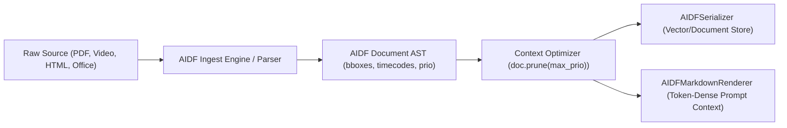

# AIDF (Agent Ingestion Document Format)

[]()
[]()
[]()
[](SPECIFICATION.md)

A multimodal document ingestion intermediate representation (AST) for AI Agents, RAG pipelines, and prompt context compilation.

---

## Strategic Positioning & Architecture (v0.2)

AIDF is designed as a **multimodal document ingestion and intermediate representation (AST)** for agent and RAG workflows. It bridges PDF bounding boxes, video timecodes, citation graphs, and priority-tier context budgets.



When stuffing context into LLM prompt windows, AIDF documents can be:
1. **Rendered to Clean Markdown (`AIDFMarkdownRenderer`)**: Compiles the AST into token-dense CommonMark / GFM for prose to minimize inference costs and maximize LLM prompt cache hits.
2. **Pruned by Priority Tier (`doc.prune(max_prio=1)`)**: Eliminates low-priority sections to fit strict context budgets.
3. **Streamed Incremental Events (`AIDFStreamingParser`)**: Emits completed nodes (sections, tools, tables, video segments) in real time without buffer corruption.

---

## Features
- **Deterministic AST Parsing**: Strict tag closures with safe escaping for mathematical comparisons (`5 < 10`, `if x < y:`).
- **Dynamic Context Budgeting (`prio=1..3`)**: Instant token pruning before prompt injection without breaking document grammar.
- **Native Multimodal Nodes**: Spatial bounding boxes (`bbox=[ymin, xmin, ymax, xmax]`), video/audio timestamps (`t_start`, `t_end`), and parallel visual + OCR / caption tracks.
- **Typed Tabular Data**: Supports both compact schema tables (`cols="..."`) with structured `<row>["..."]</row>` JSON arrays and pipe-escaped rows.
- **Prompt Injection Defense**: `<data:untrusted>` sandbox containers with breakout sanitization.
- **Exact Citation Anchors**: Grounded node `#id` references.
- **Token-Dense Markdown Rendering**: First-class AST-to-Markdown renderer for prompt stuffing.
- **Pluggable Storage & Citation Graph**: `InMemoryAIDFStore` supporting entity extraction, document indexing, and citation subgraph traversals (`p-1 -> ref-1 -> tbl-1`).

---

## Quickstart

### 1. Validate an AIDF File
```bash
python3 -m aidf.cli validate document.aidf
```

### 2. Convert Markdown to AIDF
```bash
python3 -m aidf.cli convert README.md -o README.aidf
```

### 3. Prune Document for Context Windows (Retain only prio=1 critical text)
```bash
python3 -m aidf.cli prune document.aidf --max-prio 1 -o prompt_context.aidf
```

### 4. Render AIDF to Token-Dense Markdown (For LLM Prompt Context)
```bash
python3 -m aidf.cli render document.aidf --max-prio 2 -o prompt_context.md
```

---

## Python API Usage

```python
from aidf.parser import AIDFParser, AIDFSerializer
from aidf.markdown_renderer import AIDFMarkdownRenderer

raw_markup = """<doc id="report" prio=1>
  <sec id="sec-1" title="Summary" prio=1>
    <p id="p-1" prio=1>Critical launch update.</p>
    <p id="p-2" prio=3>Optional supplementary footnote.</p>
    <data:table id="tbl-perf" cols="Route:str, P95:num:ms" prio=1>
      <row>["/api/v1/search", 45]</row>
    </data:table>
  </sec>
</doc>"""

# 1. Parse into structured AST
doc = AIDFParser.parse(raw_markup)

# 2. Prune for prompt window (strips prio=3)
pruned_doc = doc.prune(max_prio=1)

# 3. Option A: Serialize back to AIDF for storage or vector DB
print(AIDFSerializer.serialize(pruned_doc))

# 4. Option B: Render to clean, token-dense Markdown for prompt stuffing
print(AIDFMarkdownRenderer.render(pruned_doc))
```

---

## RAG Framework Integrations

### LangChain Loader
```python
from aidf.adapters import AIDFLangChainLoader

loader = AIDFLangChainLoader("sample.aidf", max_prio=2)
docs = loader.load()
```

### LlamaIndex Reader
```python
from aidf.adapters import AIDFLlamaIndexReader

reader = AIDFLlamaIndexReader(max_prio=2)
nodes = reader.load_data("sample.aidf")
```

---

## Testing & Benchmarks

Run the test suite across all parser, streaming, resilience, and renderer modules:

```bash
python3 tests/test_parser.py
python3 tests/test_adapters_and_streaming.py
python3 tests/test_resilience.py
python3 tests/test_fixes.py
```

Run token density benchmarks against `cl100k_base`:

```bash
python3 benchmarks/benchmark_tokens.py
```

---

## License

MIT License. See [LICENSE](LICENSE) for details.
