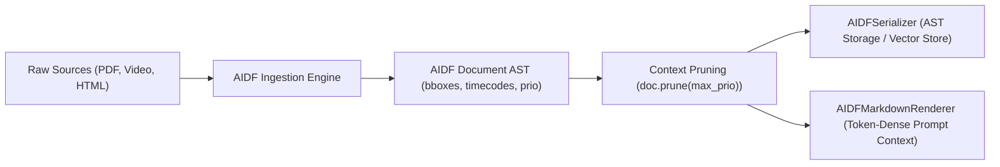

# AIDF: Agent Ingestion Document Format Specification (v0.2)

## 1. Motivation & Problem Statement
Markdown was designed in 2004 as an email-friendly, human-readable text-to-HTML shorthand. While ubiquitous, it exhibits significant flaws when ingested and manipulated by multimodal AI systems:
1. **Ambiguous Delimiters**: Nested lists, tables with raw pipe characters, and multi-level blockquotes often break AST parsers or confuse tokenizers.
2. **Missing Multimodal Primitives**: Standard Markdown `` cannot express bounding boxes, video timestamps, audio transcripts, crop regions, or dual-layer visual+OCR layouts.
3. **No Dynamic Context Pruning / Token Budgeting**: Markdown treats all content uniformly. LLMs and RAG systems lack intrinsic annotations on what text can be pruned under tight context windows.
4. **Poor Retrieval Grounding**: Markdown lacks stable, unambiguous element-level identifiers for direct citation, provenance, and tool-action anchoring.

**AIDF (Agent Ingestion Document Format)** serves as an open, multimodal **Intermediate Representation (AST)** for document ingestion pipelines (PDFs, earnings calls, slides, videos) and retrieval-augmented generation (RAG).

To solve the token overhead and prompt caching penalties of raw XML in LLM context windows, AIDF provides dual rendering modes:
- **Canonical AIDF**: Rich bracket-tagged XML-compatible markup for deterministic storage, AST manipulation, and streaming event triggers.
- **Token-Dense Markdown (`AIDFMarkdownRenderer`)**: Compiles the pruned AIDF AST into clean, high-density CommonMark/GFM for prompt injection.

---

## 2. Design Principles
- **Unambiguous Boundaries**: Strict closing tags and automatic escaping of comparisons (`<`, `&`) ensure deterministic AST generation without regex guessing.
- **Multimodal First**: Native elements for bounding boxes (`bbox=[ymin, xmin, ymax, xmax]`), spatial coordinates, time-offsets, OCR fallbacks, and multi-channel transcripts.
- **Context-Window Awareness**: Inherent `prio` (priority 1..3) annotations allowing dynamic pruning passes before prompt injection.
- **Dual Pipeline Egress**: Store and index rich multimodal ASTs in AIDF; render to token-dense Markdown or native JSON tool calls during prompt injection.
- **Citation & Grounding Anchors**: Every major node supports stable IDs (`#id`) for exact vector/agent references.

---

## 3. Core Syntax & Grammar

### 3.1 Syntax Conventions
Tags use XML-compatible bracket delimiters:
- **Block tags**: `<tag:type [attributes]> ... </tag:type>`
- **Void/Self-closing tags**: `<tag:type [attributes]/>`
- **Attribute syntax**: `key="val"` or shorthand numeric/array notation `prio=1`, `bbox=[0.1, 0.2, 0.8, 0.9]`.
- **Character Escaping**: Bare mathematical operators (such as `5 < 10` or `if x < y:`) and bare ampersands are safely tokenized by the parser without requiring manual CDATA wrapping.

### 3.2 Document Root & Metadata
```aidf
<doc id="q3-financial-report" prio=1 lang="en">
  <meta>
    <src title="Alphabet Q3 2026 Earnings" uri="s3://reports/2026-q3.pdf" pages=42/>
    <embed model="text-embedding-3-large" dim=3072/>
  </meta>
  ...
</doc>
```

---

## 4. Key Primitives

### 4.1 Hierarchical Sections & Priority Pruning
Sections define explicit boundaries and pruning priorities (`prio=1` critical, `prio=2` standard, `prio=3` optional/elidable):

```aidf
<sec id="sec-rev" title="Revenue Breakdown" prio=1>
  <p id="p-1" prio=1>Google Services revenue increased 12% year-over-year.</p>
  
  <sec id="sec-rev-details" title="Sub-segment commentary" prio=3>
    <p id="p-detail" prio=3>Hardware inventory adjustments contributed negligible headwind during July.</p>
  </sec>
</sec>
```
*Agents can run `doc.prune(max_prio=1)` to automatically drop `prio=3` and `prio=2` sections under tight context constraints.*

---

### 4.2 Multimodal Nodes

#### A. Images with Spatial Anchors & Dual Modality (Visual + OCR/Dense Caption)
```aidf
<media:img id="fig-3" src="asset://page-12.png" page=12 bbox=[0.12,0.25,0.85,0.65] prio=1>
  <caption>Consolidated Statement of Income (Operating Margin vs OpEx)</caption>
  <ocr conf=0.98>Total Revenues: $88,268M | Costs & Expenses: $59,743M</ocr>
  <desc prio=2>Bar chart displaying quarterly growth from Q1 to Q3 2026.</desc>
</media:img>
```
- `bbox`: Normalized coordinates `[ymin, xmin, ymax, xmax]`.
- `ocr`: Text detected inside the media with optional confidence score.
- When ingested by vision-capable models, the raw image or cropped slice is fed along with `<ocr>` as a verified textual fallback.

#### B. Audio & Video Segments (Time-coded Multimodal Anchor)
```aidf
<media:video id="vid-1" src="asset://call-recording.mp4" t_start="00:14:22" t_end="00:15:10" prio=1>
  <speaker name="Sundar Pichai" id="spk-1"/>
  <transcript>
    We continue to invest aggressively in TPUs and custom silicon infrastructure.
  </transcript>
</media:video>
```

---

### 4.3 Structured Data & Tables
AIDF supports two formats for structured tabular data:

#### Format A: JSON Array Rows (Recommended for complex data)
Eliminates pipe ambiguity entirely for code and mathematical content:
```aidf
<data:table id="tbl-perf" cols="Endpoint:str, Latency:num:ms, Status:str" prio=1>
  <row>["/api/v1/search", 45, "OK"]</row>
  <row>["/api/v1/checkout", 120, "DEGRADED"]</row>
</data:table>
```

#### Format B: Pipe-Delimited Tables (with Escape Support)
Allows traditional pipe-style rows with escaped pipe (`\|`) support for mathematical operators (e.g. `|x|`):
```aidf
<data:table id="tbl-q3-sum" cols="Quarter:str, Revenue:num:USD_M, YoY:pct" prio=1>
  | Q3 2025 | 76693 | +11% |
  | Q3 2026 | 88268 | +15% |
</data:table>
```

---

### 4.4 Citations, References, & Grounding
Enables LLM agents to cite pinpoint sources in their answers:

```aidf
<p id="p-412">
  The cloud backlog stood at $86B, representing a 
  <ref target="tbl-q3-sum">15% increase</ref> from previous benchmarks.
</p>
```

---

## 5. Dual Pipeline Architecture (Ingestion IR vs. Context Prompting)

To balance rich metadata extraction with token density in LLM prompts, AIDF operates as a dual-phase system:



1. **Document Storage & Indexing:** Full AIDF markup preserves all multimodal coordinates and metadata.
2. **LLM Context Stuffing:** `AIDFMarkdownRenderer.render(doc)` emits clean Markdown (retaining alt text, OCR, tables, and section headings) to eliminate XML wrapper overhead and maximize LLM prefix prompt caching.

---

## 6. Implementation Architecture & Streaming

### 6.1 Streaming Token Parser (`AIDFStreamingParser`)
Consumes streaming LLM tokens incrementally and emits events as individual nodes close (`on_node_closed`, `on_tool_ready`). Supports:
- `<sec>` and `<media:video>` block event detection
- Multi-event closure per token chunk
- Slice-based buffer consumption to prevent duplicate token stripping

### 6.2 Resilient Fallbacks (`ResilientAIDFParser`)
Engineered to withstand unclosed tags and auto-heal markdown fences from LLM responses, ensuring agents do not crash on imperfect output.
