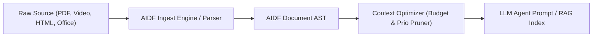

# AIDF: Agent Ingestion Document Format Specification (v0.1-draft)

## 1. Motivation & Problem Statement
Markdown was designed in 2004 as an email-friendly, human-readable text-to-HTML shorthand. While ubiquitous, it exhibits significant flaws when ingested by LLM agents:
1. **Ambiguous Delimiters**: Nested lists, tables with raw pipe characters, and multi-level blockquotes often break AST parsers or confuse tokenizers.
2. **Missing Multimodal Primitives**: Standard Markdown `` cannot express bounding boxes, video timestamps, audio transcripts, crop regions, or dual-layer visual+OCR layouts.
3. **No Dynamic Context Pruning / Token Budgeting**: Markdown treats all content uniformly. LLMs and RAG systems lack intrinsic annotations on what text can be pruned under tight context windows.
4. **Poor Retrieval Grounding**: Markdown lacks stable, unambiguous element-level identifiers for direct citation, provenance, and tool-action anchoring.

**AIDF (Agent Ingestion Document Format)** is an open, token-dense, bracket-tagged representation tailored for AI agents, multi-modal ingestion pipelines, and retrieval-augmented context injection.

---

## 2. Design Principles
- **Unambiguous Boundaries**: Strict closing tags or self-closing brackets ensure deterministic AST generation without regex guessing.
- **Token Efficiency**: Compact attribute abbreviations and concise tag names reduce sub-token overhead compared to standard HTML or verbose XML.
- **Multimodal First**: Native elements for bounding boxes, spatial coordinates, time-offsets, OCR fallbacks, and multi-channel transcripts.
- **Context-Window Awareness**: Inherent `prio` (priority) annotations allowing dynamic pruning passes when stuffing context into prompt windows.
- **Citation & Grounding Anchors**: Every major node supports stable IDs (`#id`) for exact vector/agent references.

---

## 3. Core Syntax & Grammar

### 3.1 Syntax Conventions
Tags use bracket delimiters `@<tag ...>` or `<tag ...>`:
- **Block tags**: `<tag:type [attributes]> ... </tag:type>`
- **Void/Self-closing tags**: `<tag:type [attributes]/>`
- **Attribute syntax**: `key="val"` or shorthand numeric/flag notation `key=val`.

### 3.2 Document Root & Metadata
```aidf
<doc id="q3-financial-report" prio="1" lang="en">
  <meta>
    <src title="Alphabet Q3 2026 Earnings" uri="s3://reports/2026-q3.pdf" pages=42/>
    <embed model="text-embedding-3-large" dim=3072/>
  </meta>
  ...
</doc>
```

---

## 4. Key Primitives

### 4.1 Hierarchical Sections & Priority Pruning
Sections define explicit boundaries and pruning priorities (`prio=1` critical, `prio=3` optional/elidable):

```aidf
<sec id="sec-rev" title="Revenue Breakdown" prio=1>
  Google Services revenue increased 12% year-over-year.
  
  <sec id="sec-rev-details" title="Sub-segment commentary" prio=3>
    Hardware inventory adjustments contributed negligible headwind during July.
  </sec>
</sec>
```
*Agents can run a `prune(max_tokens=2048, min_prio=2)` pass that automatically strips `prio=3` sections without breaking semantic grammar.*

---

### 4.2 Multimodal Nodes

#### A. Images with Spatial Anchors & Dual Modality (Visual + OCR/Dense Caption)
```aidf
<media:img id="fig-3" src="asset://page-12.png" page=12 bbox=[0.12,0.25,0.85,0.65] prio=1>
  <caption>Consolidated Statement of Income (Operating Margin vs OpEx)</caption>
  <ocr conf=0.98>Total Revenues: $88,268M | Costs & Expenses: $59,743M</ocr>
  <desc prio=2>Bar chart displaying quarterly growth from Q1 to Q3 2026.</desc>
</media:img>
```
- `bbox`: Normalized coordinates `[ymin, xmin, ymax, xmax]`.
- `ocr`: Text detected inside the media with confidence score.
- When ingested by vision-capable models, the raw image or cropped slice is fed along with `<ocr>` as a sanity check.

#### B. Audio & Video Segments (Time-coded Multimodal Anchor)
```aidf
<media:video id="vid-1" src="asset://call-recording.mp4" t_start="00:14:22" t_end="00:15:10">
  <speaker name="Sundar Pichai" id="spk-1"/>
  <transcript>
    We continue to invest aggressively in TPUs and custom silicon infrastructure.
  </transcript>
</media:video>
```

---

### 4.3 Structured Data & Dense Tables
Standard Markdown tables are token-heavy (requiring spaces and repeated hyphens) and fail on multiline cells. AIDF introduces compact typed record tables:

```aidf
<data:table id="tbl-q3-sum" cols="Quarter:str, Revenue:num:USD_M, YoY:pct">
  | Q3 2025 | 76693 | +11% |
  | Q3 2026 | 88268 | +15% |
</data:table>
```
- Includes typed schema headers for instant tool/code interpreter consumption.

---

### 4.4 Citations, References, & Grounding
Enables LLM agents to reference pinpoint sources in their answers:

```aidf
<p id="p-412">
  The cloud backlog stood at $86B, representing a 
  <ref target="tbl-q3-sum" cell="[1,2]">15% increase</ref> from previous benchmarks.
</p>
```

---

## 5. Markdown vs. AIDF Comparison

| Dimension | Standard Markdown | AIDF (Agent Ingestion Doc Format) |
| :--- | :--- | :--- |
| **Parsing Determinism** | ⚠️ Ambiguous (indentation-based, loose AST) | 🟢 Deterministic (strict XML/tag boundaries) |
| **Multimodal Support** | ❌ Minimal (`` only) | 🟢 Native Bounding Boxes, Video timestamps, Dual OCR/Cap |
| **Token Budgeting** | ❌ None (uniform token cost) | 🟢 Native `prio` tags for automated RAG/prompt pruning |
| **Data / Tabular** | ⚠️ Fragile pipes, no typed schemas | 🟢 Compact typed row streams |
| **Target Citation** | ❌ None (requires external line indexers) | 🟢 Built-in `#id` targets for precise LLM grounding |

---

## 6. Implementation Architecture



---

## 7. Next Steps & Roadmap
1. **Schema & AST Definition**: Formalize Pydantic / TypeScript types for AST nodes.
2. **Parser & Serializer**: Lightweight streaming parser (`aidf-py` or `aidf-ts`).
3. **Markdown-to-AIDF & PDF-to-AIDF Converters**: CLI tool to ingest existing docs.
4. **Token Benchmarking**: Compare token usage of Markdown vs. AIDF across real-world enterprise documents.
